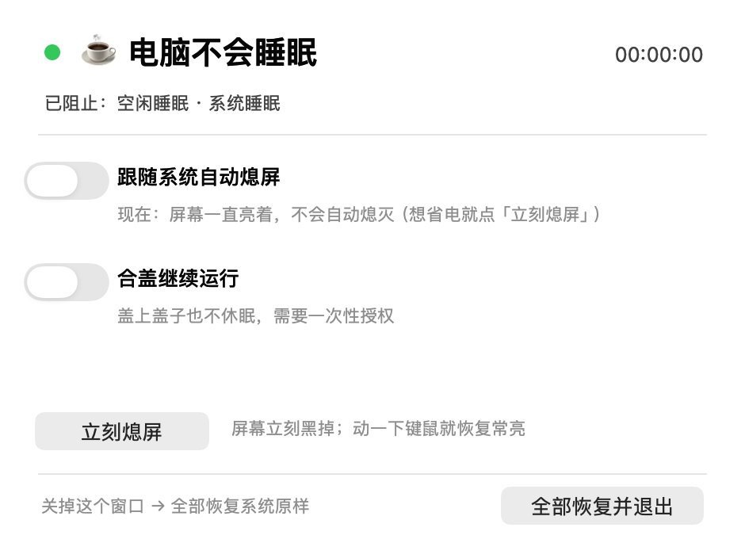

# 电脑不休眠 · Keep Awake for macOS

> 作者：[九七](https://github.com/Jax-97) · 一个双击就用的 macOS 电源小工具
>
> 本项目属于 **97tool** 系列：自用为主、能双击就不敲命令的小工具集。

**不让电脑睡、屏幕常亮、立刻熄屏、合盖继续跑**。原生 Swift/AppKit 单文件实现，无第三方依赖、无后台常驻服务、关掉即恢复系统原样。



## 为什么做这个

macOS 自带的「防止睡眠」要么藏在命令行（`caffeinate`），要么在「系统设置 → 锁定屏幕」里翻好几层，而且**合盖休眠**根本没有开关。这个 App 把常用的几种状态做成一个窗口里的开关和按钮，双击即用、关掉即还原。

## 功能

| 功能 | 实现机制 | 需要权限 |
|---|---|---|
| 系统不睡眠 | `caffeinate -is -w <AppPID>` 常驻断言 | 无 |
| 屏幕常亮（默认开） | 另一个 `caffeinate -d -w <AppPID>` | 无 |
| 跟随系统自动熄屏（开关） | 撤掉 `-d` 断言，交还系统空闲计时 | 无 |
| 立刻熄屏 | `pmset displaysleepnow`（熄灭前先撤 `-d` 断言，否则会被系统顶回亮） | 无 |
| 合盖继续运行（开关） | `sudo pmset -a disablesleep 1` | 一次性授权 |
| 关闭窗口 / ⌘Q | 撤掉全部断言 + `disablesleep 0` | — |

所有断言都通过 `-w <AppPID>` 绑定到 App 进程：**即使 App 崩溃或被 `kill -9`，睡眠规则也会自动释放**，不会留下「永远不休眠」的僵尸状态。

## 安装

需要 macOS 11+ 和 Xcode Command Line Tools（`xcode-select --install`）。

```bash
git clone https://github.com/Jax-97/97tool-keep-awake.git
cd 97tool-keep-awake
./build.sh                 # 生成 电脑不休眠.app
mv 电脑不休眠.app ~/Desktop/
```

双击打开即可。想开机自启：系统设置 → 通用 → 登录项 → 添加这个 App。

### 合盖继续运行（可选，一次性授权）

「合盖不休眠」在 macOS 里没有图形开关，只能改 root 级别的电源设置：

```bash
sudo pmset -a disablesleep 1    # 合盖不睡
sudo pmset -a disablesleep 0    # 恢复
```

为了不让你每次点开关都输密码，仓库里的 `启用合盖继续跑.command` 会做两件事：

1. 安装一个**只做这一件事**的 root 辅助脚本 `/usr/local/bin/keepawake-lid`（只接受 `0` / `1` / `status` 三个参数）；
2. 在 `/etc/sudoers.d/keepawake` 里加一条**只针对这个脚本**的免密码规则。

它不会给你开任何其它 root 权限。双击运行、输一次密码即可。

**撤销授权：**

```bash
sudo rm -f /usr/local/bin/keepawake-lid /etc/sudoers.d/keepawake
```

## 已知限制（先说清楚，免得踩坑）

- **屏幕熄灭 ≠ 电脑睡眠**：熄屏时 CPU、下载、渲染都在继续，实测熄屏 45 秒心跳不中断。
- **`-s` 只在接电源时生效**：电池供电靠 `-i` 顶住空闲睡眠，日常够用；但**电量很低时系统会强制休眠**，任何 App 都挡不住。
- **合盖不休眠会积热**：合盖后放在包里跑大任务有风险，界面会有橙色提醒。
- **别的软件会拦熄屏**：微信放视频/语音、视频会议等会自己向系统申请「别熄屏」，这时点「立刻熄屏」可能被顶回来，App 会在小字里指出是哪个软件在拦。

## 代码结构

```
app/main.swift                       全部逻辑（约 500 行，单文件 AppKit）
app/Info.plist                       Bundle 配置
assets/AppIcon.icns                  图标
启用合盖继续跑.command                一次性授权脚本（合盖功能用）
build.sh                             构建脚本
```

调试用参数：

```bash
电脑不休眠.app/Contents/MacOS/KeepAwake --selftest            # 跑一遍真实代码路径的行为自检
电脑不休眠.app/Contents/MacOS/KeepAwake --snapshot out.png    # 把窗口离屏渲染成 PNG（不需要录屏权限）
```

## License

MIT
